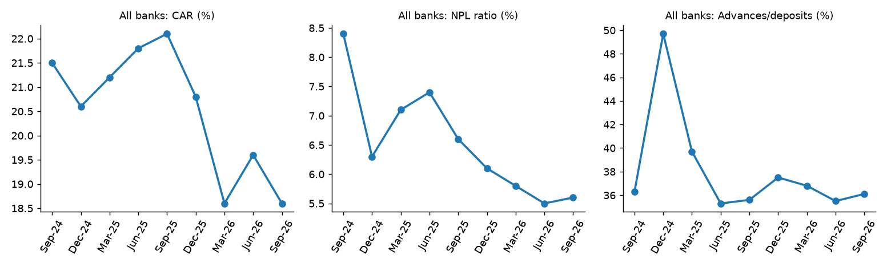
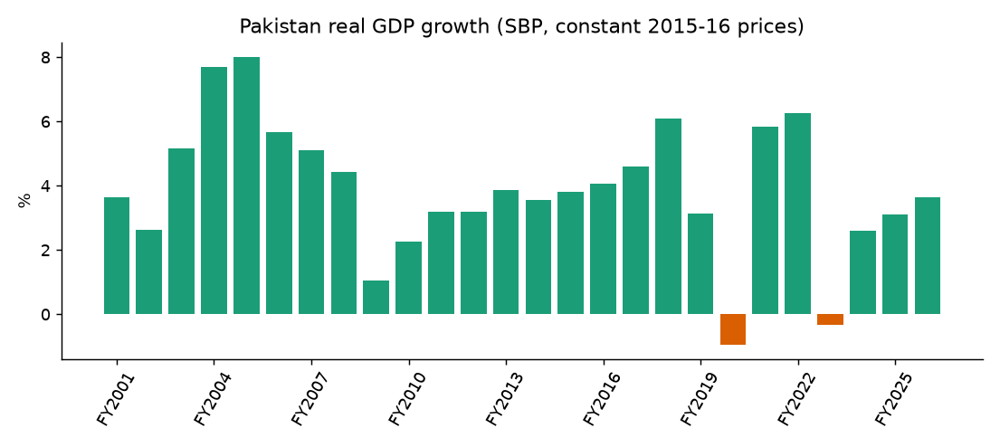
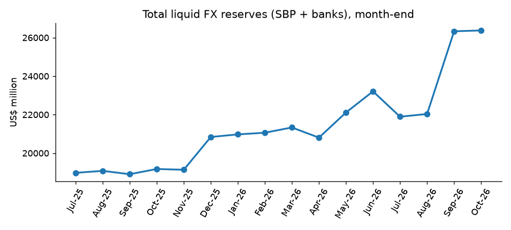
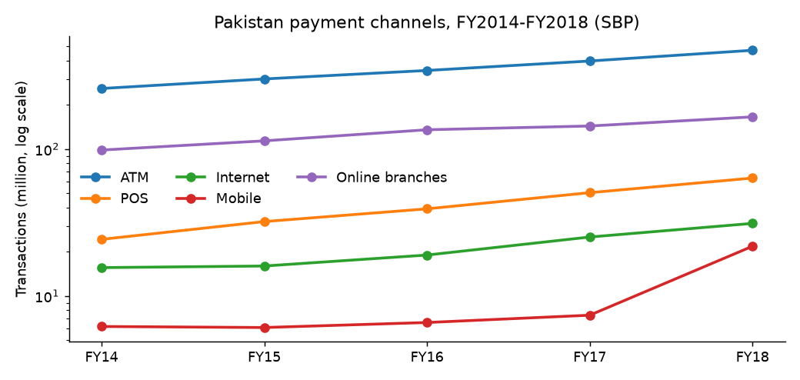
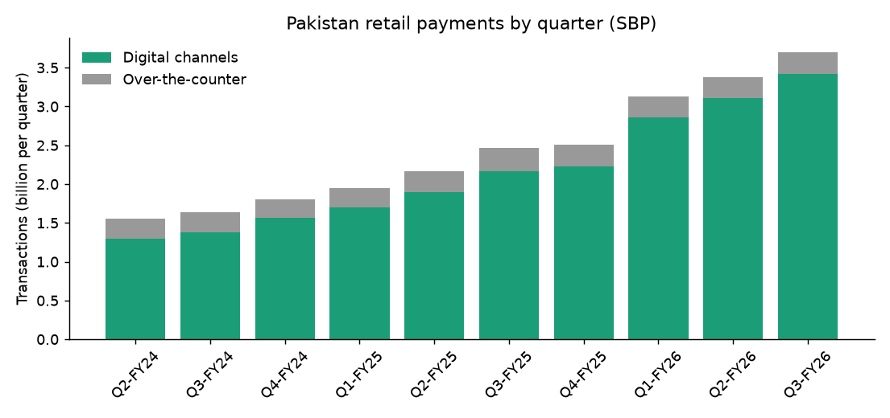
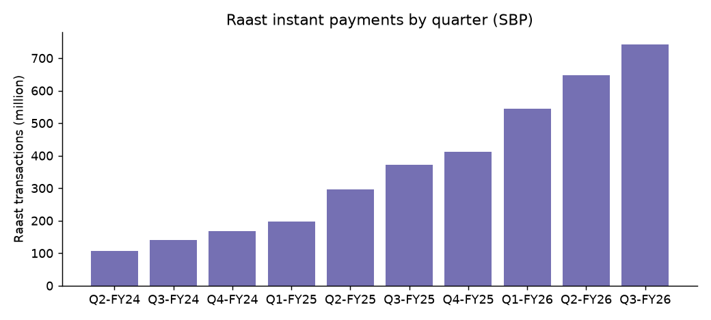
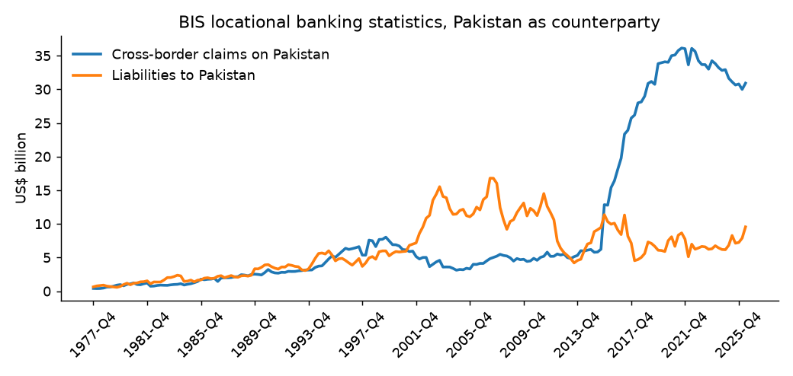
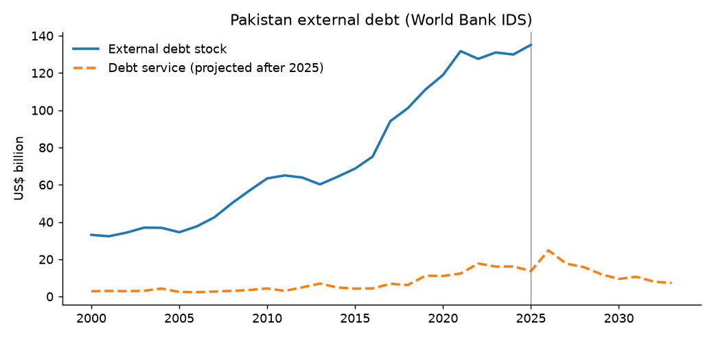
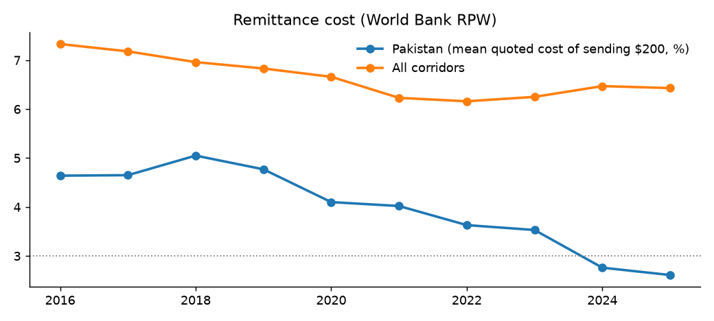
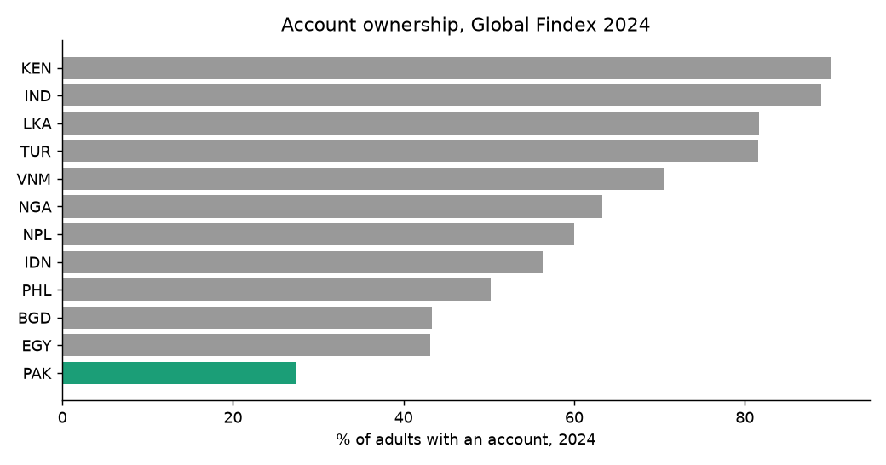

# All-in-one analysis of the NovaBank data warehouse (real data)

One document covering every real dataset in the warehouse that bears on Pakistan banking and payments: State Bank of Pakistan (SBP), BIS, World Bank (WDI, IDS, Remittance Prices, Global Findex), ECB, FRED and the PaySim simulator reference. Generated by `scripts/allinone/` (parts A to H, merged by `build_all_in_one.py`; data in `docs/_parts/*.json`). It extends and, where noted, corrects the earlier single-topic reports (`PAKISTAN_ANALYSIS.md`, `PAKISTAN_WDI_ANALYSIS.md`, `SBP_ANALYSIS.md`, `BIS_CPMI_ANALYSIS.md`, `PAYSIM_FRAUD_RESULTS.md`, `MACRO_PAYMENTS_JOIN.md`).

**Contents:** A Banking-system health, B Macro economy, C Payment systems (FY2018), C2 Current payments (SBP quarterly, to Mar 2026), D Cross-border finance, E Global context, F WDI screen, G Financial inclusion, H Data quality and reconciliation.

Dates: the warehouse files run to November 2026; "latest" means the latest value in the files, which differs by source.

## Executive summary

**Macro and monetary position (Part B, E).** SBP's policy rate is 12.0% (Oct 2026); in real terms (Dec-2025 rate less 2025 inflation) it is 6.95%, third highest of 38 countries. The rupee has been stable near 277 per dollar and total liquid reserves reached US$ 26.4bn in Oct 2026, 2.88x the June 2023 low. Growth is modest (3.05% average over the last five years). The current account moved from a US$ 1.8bn surplus in FY25 to a US$ 391m deficit in FY26 as imports rose 9.1% and exports fell 4.7%; remittances of US$ 41.6bn (+8.6%) covered 123.4% of the goods trade deficit.

**Banks (Part A).** Capital is solid (CAR 18.6%) and the gross NPL ratio is 5.57% (down from 8.4% two years earlier), but 83.3% of NPLs are in the 'loss' category and the 'doubtful' bucket rose 55.5% in the latest quarter. Return on equity is 18.6% but falling and the cost/income ratio rose from 42.9% to 50.4%. Banks lend little: advances are 36.1% of deposits and about 72.8% of credit goes to government (Jun-26). Compared with euro-area significant banks, Pakistan's NPL ratio is about 2.6 times higher and its ROE about 1.7 times higher (Part E).

**Credit depth and inclusion (WDI doc, Part F, G).** Private credit is 10.7% of GDP, the lowest of 12 peers (median 44.0%). Only 27.3% of adults have an account (rank 148 of 153); **11.9% of women do, the lowest of all 153 economies**, and the gender gap (30.4 points) is the second largest. Mobile-money accounts (18.4%) now roughly equal bank accounts (18.3%).

**Payments (Part C2, C).** Retail payments through formal channels were 3,697 million in Q3 FY26 (+50.2% on a year earlier), 92.4% digital by volume but only 40.4% by value (bank branches still carry about 59% of value). Branchless-banking wallet apps are 58.5% of volume and mobile banking apps 18.0%, while ATM volume has stalled (+2%) and card-present POS grew 45%. Raast instant payments reached 742 million (Rs 23.3 trillion) in the quarter, 6.9x two years earlier. Card payments per person are 2.37 a year (0.29 in FY2018) and card payments per cash withdrawal 0.44 (0.14 in FY2018, against 0.99 for Indonesia and 1.1 for India in 2018). BIS data across 23 countries show card payments and account transfers growing every year while cheques fell, and India's card use flat while account-to-account transfers rose more than tenfold.

**External finance (Part D).** External debt is US$ 135.1bn (34% of GNI), with debt service taking 33% of exports and **scheduled service of US$ 24.8bn in 2026** (about the size of reserves). Foreign banks' cross-border claims on Pakistan are US$ 30.9bn. Sending money to Pakistan costs 2.61% on average (against 6.43% worldwide) but banks charge 6.29% against 2.46% for money-transfer operators.

**What the earlier synthetic-data work can and cannot say.** The NovaBank payments data is synthetic and has no macro inputs, so it shows no relationship to any real series (as it should). The fraud result on the PaySim simulator (PR-AUC 1.0) reflects a rule built into the simulator, not real fraud detection. The only real-transaction fraud result is on public European card data: XGBoost PR-AUC 0.7888 (95% interval 0.719-0.848), anonymised 2013 data that does not transfer to Pakistan. Nothing here validates the synthetic generator against real Pakistani payment behaviour; Part C gives real benchmarks that a future generator calibration could use.

**Reliability.** 13 of 16 cross-source checks pass (Part H): exchange rates from four sources agree, GDP growth recomputes exactly, SBP identities hold, and the World Bank and IDS debt totals match. The SBP tables are OCR extractions and have not been checked cell by cell against the PDFs.

## A. Banking-system health (SBP Quarterly Compendium Sep-2026 and deposit/advance series)

**Capital and asset quality are strong on the headline, with some weak spots.**
- Risk-weighted capital adequacy (all banks) is 18.6% (Sep-26) against 21.5% two years earlier; Tier 1 is 15.7%. By group: public sector 19.0%, local private 17.2%, foreign 54.9%, digital 31.6%, specialized 44.5%.
- **Gross NPL ratio 5.57% (Sep-26)**, down from 8.4% in Sep-24: NPLs of Rs 930bn on gross advances of Rs 16.68tn. Advances grew 16.7% in the year while NPLs fell 1.9%. By group: public sector 11.9%, local private 4.2%, foreign 0.1%, digital 2.9%, specialized 14.1%.
- Provisions cover 105.8% of NPLs, so net NPLs are negative (Rs -54bn). But **83.3% of NPLs are in the 'loss' category** (the longest-overdue category), and the 'doubtful' bucket jumped 55.5% in one quarter (Rs 63bn to Rs 98bn), an early deterioration signal. Net NPLs also moved from -Rs 120bn to -Rs 54bn over the year as provisions fell faster than NPLs.
- Profitability is high but easing: ROE after tax 22.5% to 18.6%, ROA after tax 1.3% to 1.1%, and the cost/income ratio rose from 42.9% to 50.4%, consistent with falling interest rates compressing margins (a reading, not tested).
- 

**Lending mix.** Banks are liquid (liquid assets 103.0% of deposits) and lend little: the all-banks advances-to-deposits ratio is 36.1% (Sep-26). Corporate and SME lending is 54.3% of loans, domestic public-sector loans 21.3%, and FX loans rose from 12.9% to 15.0%.

**Where the bad loans are (Sep-26).** Highest NPL ratios among large sectors: Construction 10.6% (Rs 364bn); Electronics 8.3% (Rs 219bn); Sugar 8.0% (Rs 473bn); Wholesale and Retail Trade 7.7% (Rs 856bn); Textile 7.0% (Rs 2,500bn). Lowest: Individuals 2.3%; Chemical & Pharmaceuticals 1.2%; Transportation,Storage andCommunication 1.0%; Financial 0.6%. Consumer lending has the lowest NPL ratio of the segments (3.3%; credit cards 1.9%) and SME and agriculture loans the highest (10.7% and 10.7%).

**Stress tests (SBP, Sep-26).** 16 scenarios were parsed. In the worst single scenario 1 of 32 banks fall below 8% CAR and none goes below 0%. The critical infection ratio (the NPL ratio at which capital is wiped out) is 61.3% against the current 5.6% (read from the SBP table text).

**The late-2024 advances spike is real in SBP's published data.** The weekly advances series jumps 30% between Sep and Dec 2024. SBP's own all-banks advances-to-deposits ratio in the compendium moves 36.3% (Sep-24), 49.7% (Dec-24), 39.7% (Mar-25), so it is not an OCR error. The cause is not stated in these files; a temporary year-end surge is the most likely reading but I have not verified that.

## B. Macro economy (SBP tables, cross-checked against BIS and World Bank)

**Growth is modest and volatile.** Real GDP growth (constant 2015-16 prices, FY2001-FY2026) averages 3.9% a year with a standard deviation of 2.1 pp; the last five years average 3.05%. Best year FY2005 (8.0%); contractions only in FY2020 (-0.94%, COVID) and FY2023 (-0.33%, the year of the exchange-rate and inflation crisis). Parsing check: growth recomputed from the GDP levels matches SBP's published growth row exactly. The economy has shifted toward services: services 52.2% of GDP in FY2001 to 58.3% in FY2026, agriculture 30.6% to 23.6%, industry 17.2% to 18.1%; over FY2016-FY2026 services grew 3.68% a year, agriculture 3.2%, industry 2.63%.
- 

**Balance of payments, FY2025 to FY2026 (US$ million, Jul-Jun).** The current account swung from a surplus of 1,838 to a deficit of 391. Goods exports fell 4.7% (to 30,836) while imports rose 9.1% (to 64,527), widening the goods trade deficit from 26,803 to 33,691. Workers' remittances rose 8.6% to 41,585 and covered 123.4% of the goods trade deficit; services exports rose 18.9%. Foreign direct investment into Pakistan fell 27.7% (to 1,792). (Column mapping of the SBP table was inferred from its header: first column Jul-Jun FY25, third column Jul-Jun FY26.)

**FX reserves rebuilt strongly.** Total liquid reserves (SBP plus banks) were US$ 15.4bn at June 2022, fell to US$ 9.2bn at June 2023 (the crisis low), then rose to 14.0bn, 19.3bn and 23.2bn at June 2026; Oct 2026 is US$ 26.4bn, 2.88x the June 2023 level. Most of the Sep-26 jump (US$ 21.9bn to 26.3bn) is in SBP's own reserves; the source does not say why.
- 

**Money.** Broad money (M2) grew 12.89% in FY25 and 14.7% in FY26, then contracted 4.92% from 1 July to 6 Nov 2026 (against -2.27% in the same period of 2025); reserve money grew 11.69% and 11.6% in the two fiscal years and -0.9% in Jul-Nov 2026. (Column meaning inferred from the SBP header.)

**Exchange rate: four independent sources agree.** BIS monthly average Sep-26: 277.22 PKR per USD; SBP banks' floating average Oct-26: 277.24; SBP mark-to-market ready rate on 19 Nov 2026: 276.5205; open market 19 Nov 2026: 277.24/278.35 (buy/sell spread 0.4%, selling rate 0.66% above the interbank mark-to-market rate). In the BIS monthly series the rupee was 280.5 in Jan-24, 278.3 in Sep-24, 281.5 in Sep-25 and 277.2 in Sep-26; the gap between its highest and lowest monthly average since Sep-24 is 2.5%, so the rate has been very stable.

**Inflation reconciliation (closes an earlier caveat).** SBP's fiscal-year average CPI and the World Bank's calendar-year CPI differ by 1.31 pp on average over FY12-FY19 (largest gap FY19: 7.3% vs 10.6%, because calendar 2019 mixes two fiscal years). The two sources agree on level and direction once the period definitions are accounted for; the SBP inflation snapshot in the warehouse only covers FY12 to Nov-18, so it cannot be used for the 2022-23 spike (World Bank/IMF monthly CPI covers that).

## C. Payment systems: Pakistan (SBP FY2018) against BIS, ECB and World Bank

*The SBP payment-systems data in the warehouse is the Payment Systems Review for FY2017-18 (to June 2018), so it is eight years older than the rest of this analysis. It describes the structure of Pakistan's payments in 2018; the current position, from SBP's quarterly reviews to March 2026, is in Part C2 below.*

**What moved through the system in FY2018.** 1,224 million transactions worth Rs 559 trillion (volume +13.5% on FY17). The channel volumes add up exactly to the total (check performed). By volume, electronic banking was 61.8% and paper instruments 38.1%; by value, the large-value PRISM system was 64.6% (only 1.7 million transactions at an average of Rs 212 million each) and paper instruments still 26.9%. Electronic banking rose from 52.7% of non-PRISM volume in FY2014 to 61.8% in FY2018.

**Pakistan's electronic payments were cash-out dominated.** ATMs carried 62.2% of electronic-banking volume and 94.9% of ATM transactions were cash withdrawals (average Rs 10,831); POS purchases were only 8.4% of electronic volume (average Rs 4,677). Each POS machine handled about 1,187 transactions in the year (about 3 a day) and the number of POS machines fell 1.8% in FY2018, while each ATM handled 33,569.
- 

**Fastest-growing channels (FY2018 volume growth):** mobile phone banking +195% (to 21.8 million, average Rs 18,798), e-commerce +183% (to 3.4 million, average Rs 5,500), POS +25.7%, internet banking +23.8%. Call-centre/IVR banking was flat at 0.3 million. FY2014-18 compound growth in infrastructure: ATMs 14.2% a year, POS machines 11.7%, bank branches 7.5%, internet-banking users 20.5%, mobile-banking users 19.3%.

**Cards.** 40.9 million payment cards in June 2018 (FY2014: 25.4 million; 12.7% a year): 21.7 million debit, 1.45 million credit (just 2.2% a year growth) and 8.6 million ATM-only cards. Debit cards dropped from 27.4 million (FY16) to 17.9 million (FY17) before recovering to 21.7 million; the SBP text in the warehouse does not explain the dip.

**Cross-checks.** SBP counts and World Bank ratios agree: 14,970 bank branches over the adult population implied by WDI's ATM ratio (136.7 million adults, 60.2% of the population) is 10.95 branches per 100,000 adults against WDI's 10.08.

**Against other countries in the same year (2018, BIS CPMI per capita).** Pakistan had about 0.29 card payments per person (POS plus e-commerce, 226.9 million people) against: India 7.9, Indonesia 14.2, Mexico 30.8, Saudi Arabia 34.2, China 70.1, Brazil 80.2. Card payments per cash withdrawal: Pakistan 0.14 against India 1.1, Indonesia 0.99, Saudi Arabia 0.49, Mexico 2.0, China 6.98. Pakistan's payments were more cash-out oriented than every one of these peers (SBP and BIS definitions are not identical: SBP's POS figure may exclude some card-not-present and e-money payments).

**Euro-area benchmark (ECB payment statistics, 2025).** Per inhabitant: 260.0 card payments, 98.3 credit transfers, 65.4 direct debits, 2.2 cheques; cards are 60.3% of payments, credit transfers 19.0%, direct debits 14.6%, cheques 0.5%. Card payments per inhabitant rose from 59.4 (2009) to 260.0, cheques fell from 12.6 to 2.2.

**For the NovaBank platform.** The real data supports designing for (1) account-to-account and mobile channels that were still small (2.9% and 4.1% of electronic volume) but the fastest growing, (2) low card acceptance at POS with heavy cash-out through ATMs (which matters for ATM-switching and cash logistics), (3) small tickets at POS (Rs 4,677, about US$ 38 at the 2018 average rate of 122) and larger digital transfers (Rs 18,798 on mobile, Rs 40,462 on internet banking). These are FY2018 structural facts, not current figures; the BIS finding that low-card economies such as India moved to instant account-to-account payments is context, not evidence about Pakistan after 2018.

## C2. Current Pakistani payments (SBP quarterly Payment Systems Reviews, Q2-FY24 to Q3-FY26)

*This section replaces the FY2018-only limitation of Part C. Source: six SBP quarterly reviews (Q2 FY25 to Q3 FY26, downloaded from sbp.org.pk) merged into one quarterly series; the latest report wins for each quarter. The data covers payments through formal banking and payment channels only (cash outside the system is excluded); the latest quarters are provisional.*

**Scale and shift to digital.** In Q3 FY26 (Jan-Mar 2026) retail payments were 3,697 million worth Rs 168.8 trillion: volume +50.2% and value +2.1% on a year earlier. Digital channels carried 92.4% of volume (against 83.2% in Q2-FY24) but only 40.4% of value (19.4% in Q2-FY24); bank branches still carry 58.9% of value. Digital volume is 48.1 transactions per person per year (population 241.5 million).
- 

**The volume is wallets and apps, not cards or ATMs** (Q3 FY26 shares of retail volume, year-on-year change in volume, average ticket):
| Channel | Volume (million) | Share | YoY volume | Avg ticket (Rs) |
|---|---|---|---|---|
| Branchless-banking wallet apps | 2,164 | 58.5% | +88% | 3,649 |
| Bank/MFB mobile banking apps | 665 | 18.0% | +32% | 50,512 |
| ATM/CDM | 278 | 7.5% | +2% | 18,714 |
| Banking agents (OTC) | 155 | 4.2% | -1% | 7,113 |
| POS (card present) | 143 | 3.9% | +45% | 5,573 |
| Bank branches (OTC) | 128 | 3.5% | -11% | 777,672 |
| Internet banking | 88 | 2.4% | +11% | 184,586 |
| E-money wallets (EMIs) | 59 | 1.6% | +36% | 3,081 |
| E-commerce (card not present) | 16 | 0.4% | +22% | 4,884 |
Mobile apps and wallets together are 84.6% of digital volume. ATM volume has stalled (+2% in a year; ATMs are now 7.5% of retail volume) while card-present POS grew 45% and bank-branch volume fell 11%. Credit cards are a falling share of POS volume (24.9% in Q2-FY24 to 19.6% in Q3-FY26).

**Raast instant payments.** Raast processed 742 million transactions worth Rs 23.3 trillion in Q3-FY26, 6.9x the volume of Q2-FY24 (107 million); person-to-person transfers are 664 million of that, and person-to-merchant payments rose from 1.5 million a year earlier to 55.9 million. Raast is equal to 21.7% of digital-channel volume (the two are counted on different bases, so treat this ratio as indicative).
- 

**Infrastructure (Mar 2026, change on Mar 2025).** POS machines 247,836 (+38%); QR-enabled merchants 2,506,772 (+222%); ATMs 21,377 (+8%); bank/MFB branches 20,232 (+6%); branchless-banking agents 819,397 (+13%); payment cards 68.3 million (+18%: 57.2 million debit, 3.13 million credit); mobile-banking users 28.9 million (+28%); branchless-banking app users 95.8 million (+40%). Against June 2018 (Part C): ATMs 14,019 to 21,377, POS machines 53,511 to 247,836 (4.6x), cards 40.9 million to 68.3 million.

**Terminal density against the euro area (ECB, 2025).** Pakistan has 1,026 POS terminals per million inhabitants against 62,744 in the euro area (about 1.6% of the euro-area density), and 89 ATMs per million against 706 (12.5%). Euro-area ATM numbers are falling (253,000 in 2024, 248,954 in 2025) while POS terminals rose to 22.1 million; Pakistan's ATMs are still growing (+8% a year).

**Large-value payments.** PRISM+ settled Rs 389.8 trillion in Q3-FY26 (+12.3% on a year earlier); government securities are 70.7% of the value.

**Cards and cash, now against 2018.** Card payments (card-present POS plus card e-commerce) are 2.37 per person per year (last four quarters) against 0.29 in FY2018, and 0.44 card payments per cash withdrawal (ATM, branch and agent withdrawals) against 0.14 in FY2018: about the level of Saudi Arabia in 2018 (0.49) but still well below Indonesia (0.99) and India (1.1) in 2018. For comparison, the BIS 2023 figure for India is 9.5 card and e-money payments per person and for Indonesia 34.6 (Part C and the BIS report). The FY2018 and current figures are not strictly comparable (SBP's current review adds microfinance banks, branchless banking and e-money institutions, and its channel definitions changed), so read the change as direction and rough size.

**Reliability.** The channel rows add up to SBP's published total in 10 of 11 quarters (the first quarter, Q1-FY24, is excluded because the older report layout lacks the POS and e-commerce rows), and my digital-channel totals equal the totals SBP states for Q2 and Q3 FY26 (Q3: 3,414.6 million and Rs 68.3 trillion against SBP's 3,414.5 million and Rs 68.3 trillion). SBP revises earlier quarters: Q1 FY26 retail volume was revised by +13.4% (value -5.6%) between the Q1 FY26 and Q3 FY26 reports, and Q3 FY25 by +2.2%; the latest published values are used throughout. The step-ups in some series between Q4 FY25 and Q1 FY26 (for example credit cards 2.2 to 3.1 million, branchless-banking volume) occur in the same quarter as those revisions and are not explained in the reports, so growth across that quarter should be treated with caution.

## D. Cross-border finance: banks, external debt, remittance costs

**Foreign banks' exposure to Pakistan (BIS locational banking statistics; Pakistan is a counterparty here, which I missed in an earlier pass).** Cross-border claims of BIS-reporting banks on Pakistan are US$ 30.9bn at 2026-Q2 against US$ 9.5bn of liabilities to Pakistan (net claims US$ 21.4bn). Claims peaked at US$ 36.1bn in 2021-Q3, are -13.6% over five years and -0.6% year on year. 90% of the claims are on non-banks and 9% on banks. Country detail is mostly confidential in the locational data: the reporters whose figures are visible (largest: France US$ 638m, Hong Kong 573m, Switzerland 350m, United States 270m) add up to only 8.2% of the total, so no ranking is read from that table. The consolidated statistics are more open: of US$ 3,406m of international claims at 2026-Q2, banks headquartered in Switzerland US$ 905m, the United Kingdom US$ 890m, France US$ 626m, Spain US$ 88m, Sweden US$ 61m, Japan US$ 32m account for 76.9% (the United States is not shown and is presumably confidential). BIS consolidated statistics (a different, narrower basis: international claims of domestic banks on an immediate-counterparty basis) show US$ 3.4bn at 2026-Q2 against a peak of US$ 6.9bn (2017-Q3); the two BIS bases are not comparable in level.
- 

**External debt (World Bank International Debt Statistics, to 2025).** Total external debt rose from US$ 33.1bn (2000) to 63.4bn (2010), 118.9bn (2020) and **135.1bn (2025)**, 5.8% a year. The IDS total equals WDI's external-debt figure exactly (135.11 vs 135.11) and the creditor-by-creditor rows add up to 100.0% of the total. Composition: multilateral 31.6% (US$ 42.7bn), bilateral 31.4% (42.4bn), private non-guaranteed 13.0% (17.6bn), IMF credit 10.5% (14.2bn), short-term 7.7% (10.5bn), bonds 5.0% (6.8bn), commercial banks 0.7%. Largest identified creditors: Other Multiple Lenders 28.03bn; China 22.42bn; World Bank-IDA 19.21bn; Asian Dev. Bank 16.83bn; International Monetary Fund 14.18bn; Multiple Lenders 8.17bn; Bondholders 6.8bn; Saudi Arabia 6.05bn (US$; 'Other Multiple Lenders' and 'Multiple Lenders' are pooled categories in the source). External debt is 33.9% of GNI (2020: 40.3%) and debt service takes 32.8% of exports (2010: 15.1%; 2020: 39.7%).
- Debt service paid: US$ 4.2bn (2015), 11.0bn (2020), 17.7bn (2022), 13.7bn (2025). IDS **scheduled** service on existing debt is US$ 24.8bn in 2026, then 17.7bn, 15.8bn, 11.9bn and 9.5bn; the 2026 figure exceeds the whole stock of reserves at end-2024 (US$ 18.4bn, WDI) and SBP's liquid reserves of US$ 26.4bn at Oct 2026 are only just above it. Scheduled service is what falls due on existing debt; it takes no account of new borrowing or rollovers, so it measures refinancing need and not the cash that must leave the country.
- 

**Remittance costs into Pakistan (World Bank Remittance Prices Worldwide, 6,556 provider quotes, 2016-2025).** The mean quoted cost of sending US$ 200 to Pakistan fell from 4.64% (2016) to 2.61% (2025), against 7.33% to 6.43% averaged over all corridors in the database; 34.5% of 2024-25 quotes are still above the 3% target. By sending country in 2024-25 the cheapest are Kuwait 0.35%, Bahrain 0.81%, Qatar 1.0%, United Arab Emirates 1.78%; the most expensive are United States 4.42%, Saudi Arabia 4.75%, Canada 5.0%, India 6.83%. Banks charge 6.29% on average against 2.46% for money-transfer operators; by access point, a bank branch costs 7.72% against 2.42% online. The mean FX margin is 1.11%. These are surveyed quotes, not volume-weighted actual transactions. With remittances of US$ 41.6bn in FY2026 (SBP) the cost gap between channels is material; the cheapest corridors are Gulf senders and the cheapest access points are digital, which matters for a bank's digital remittance proposition (an observation from the data, not a tested recommendation).
- 

## E. Global context: euro area, other central banks, United States

**Euro area (ECB data to Nov 2026).** The ECB deposit rate is 2.5% (20 Nov 2026): it peaked at 4.0% in Sep 2023, was cut to 2.0% by Jun 2025, and has been raised twice since (2.25% in Jun 2026, 2.5% in Sep 2026). Euro-area HICP inflation is 4.0% in 2026-10, up from 2.1% a year earlier and from 2.8% in Jun 2026 (peak since 2020: 10.6% in 2022-10). Corporate borrowing costs are 3.9% (Sep 2026) against 1.43% in Jan 2022, and bank loans to the euro-area private non-MFI sector grow 4.24% a year. EUR/USD is 1.12 (Oct 2026; low of 0.983 in 2022-10); EUR/INR 107.01. The ECB data has no Pakistani rupee series.

**Pakistani banks against euro-area significant banks (ECB supervisory statistics, 2026-Q2, vs Pakistan Sep-2026).**
| Indicator | Euro-area significant banks | Pakistan, all banks |
|---|---|---|
| Capital ratio | 20.13% (total capital; 19.9% two years earlier) | 18.6% (CAR) |
| NPL ratio | 2.17% | 5.6% |
| Return on equity | 10.73% | 18.6% (after tax) |
| Return on assets | 0.73% | 1.1% (after tax) |
| Liquidity | LCR 154.91% | liquid assets about 103% of deposits (a different measure) |
Pakistan's banks carry a bad-loan ratio about 2.6 times the euro-area level and earn a return on equity about 1.7 times higher, with comparable capital. Definitions differ (the euro-area figures are supervisory, significant institutions only; Pakistan's NPL and ROE definitions are SBP's), so this is a rough comparison.

**Policy rates across central banks (BIS, 2026-10, 35 central banks).** The median policy rate is 4.25%; the highest are Turkiye 36.0%, Russia 14.0%, Brazil 13.75%, Colombia 12.25%, Iceland 8.0%. Pakistan's 12.0% (SBP, Oct 2026) would rank 5 of 36. In real terms (Dec-2025 policy rate less 2025 average CPI inflation from the World Bank) Pakistan's rate is 6.95%, third highest of 38 countries, against a median of 1.37%. (This mixes a point-in-time rate with an annual-average inflation rate.) The United States' policy rate is 4.0% (Fed target upper bound, 19 Nov 2026; effective funds rate 3.88%) against 2.5% in the euro area, so Pakistan's policy rate sits 8 points above the Fed's with the rupee stable near 277 (an observation, not a test of any link).

**Credit conditions elsewhere (BIS).** BIS has no credit-to-GDP gap or debt-service-ratio series for Pakistan. Peers' private-sector credit-to-GDP gaps (2026-Q1, percentage points): India 4.3, Indonesia -1.3, Turkiye -24.7, China -5.1, Brazil 0.7, South Africa -4.3, Saudi Arabia 6.7, Mexico -3.1; none is above +10 (the usual warning level). Private-sector debt-service ratios: India 12.5%, Indonesia 4.2%, Turkiye 25.8%, China 19.1%, Brazil 29.8%, South Africa 8.3%, Mexico 5.3%; highest in the database: Hong Kong 34.3%, Brazil 29.8%, Norway 28.3%, Netherlands 26.1%, Turkiye 25.8%.

**United States (FRED).** CPI inflation is 3.72% a year (2026-09); peak since 2020 8.98% (2022-06). Metropolitan unemployment (334 metros, 2026-09): median 3.9%, highest El Centro, CA 18.9%, Yuma, AZ 14.7%, Visalia, CA 10.4%, lowest Rapid City, SD 2.0%, Sioux Falls, SD-MN 2.0%, Bismarck, ND 2.2%. The FRED rates files in the warehouse cover only 2025-11-19 to 2026-11-19. This is background context; it is not linked to Pakistan or to the synthetic payments data.

## F. Where Pakistan stands on 1,498 World Development Indicators

I screened every WDI series for Pakistan (1,350 have data since 2015) and ranked the latest value against all 217 countries and territories that report it (aggregates excluded; series with fewer than 100 reporting countries skipped). Size-driven series (populations, aid and flow amounts in dollars) were removed, leaving 519 ratio-type indicators (the full table is `data/processed/pakistan_wdi_screen.csv`). Pakistan's median percentile across them is 43.4; 12 sit in the lowest 3% of countries and 9 in the highest 3%. A high or low percentile is a position, not a judgement: for some of these a higher value is worse.

**Lowest 3% of countries:** Account ownership at a financial institution or with a mobile-money-service provider, female (% of population ages 15+) 11.91 (2024; percentile 0.0 of 139); Employers, female (% of female employment) (modeled ILO estimate) 0.1 (2025; percentile 0.0 of 182); Current health expenditure (% of GDP) 2.52 (2023; percentile 2.6 of 192); Trade (% of GDP) 27.19 (2025; percentile 2.2 of 138); Employment in services, female (% of female employment) (modeled ILO estimate) 18.82 (2025; percentile 2.8 of 182); Antiretroviral therapy coverage (% of people living with HIV) 16.0 (2024; percentile 0.8 of 126).
**Highest 3%:** Diabetes prevalence (% of population ages 20 to 79) 31.4 (2024; percentile 100.0 of 209); Mortality rate, neonatal (per 1,000 live births) 36.1 (2024; percentile 99.0 of 196); Share of youth not in education, employment or training, female (% of female youth population) (modeled ILO estimate) 56.6 (2025; percentile 98.9 of 182); Public and publicly guaranteed debt service (% of exports of goods, services and primary income) 27.15 (2024; percentile 98.0 of 101); Communications, computer, etc. (% of service exports, BoP) 73.89 (2025; percentile 98.5 of 135).
**Largest 10-year changes in % indicators (percentage points):** Individuals using the Internet (% of population) 10.0 to 57.3; ICT service exports (% of service exports, BoP) 13.4 to 46.1; Primary completion rate, female (% of relevant age group) 51.2 to 72.9; Tuberculosis case detection rate (%, all forms) 53.0 to 74.0; Lower secondary completion rate, female (% of relevant age group) 34.7 to 54.5; falls: Electricity production from oil sources (% of total) 36.8 to 8.2; People practicing open defecation, rural (% of rural population) 26.9 to 13.0; Risk of catastrophic expenditure for surgical care (% of people at risk) 60.5 to 33.7. Debt service on public and publicly guaranteed debt rose from 8.0% to 27.2% of exports over the decade (consistent with the IDS result in Part D). (Series that drop to exactly 0 in one year, such as the WTO 'binding coverage' ones, were excluded from the narrative as probable reporting artefacts.)
For the banking and payments questions the screen agrees with the earlier analyses: female financial access is the lowest of any country that reports it, and trade and health spending are among the lowest shares of GDP.

## G. Financial inclusion in depth (Global Findex 2024, 153 economies)

Pakistan's rank among 153 economies for the adult population:
| Measure | Pakistan | Median economy | Pakistan's rank (1 = highest) |
|---|---|---|---|
| Any account | 27.3% | 73.1% | 148 of 153 |
| Account at a financial institution | 18.3% | 70.5% | 143 of 153 |
| Mobile-money account | 18.4% | 28.8% | 59 of 93 |
| Borrowed in the past year (any source) | 69.5% | 58.1% | 26 of 108 |
| dig_acc (digital; exact definition not in the warehouse) | 19.8% | 47.7% | 94 of 108 |

- **Women:** 11.9% of Pakistani women have an account, the **lowest of all 153 economies** (rank 1 lowest). The gender gap is 30.4 percentage points, the **2nd largest** (largest: DZA 33.8, PAK 30.4, ARE 29.6) against a median gap of 4.7 points.
- **Who is excluded:** poorest 40% 13.6% vs richest 60% 36.4%; rural 21.1% vs urban 32.9%; primary education or less 18.9% vs secondary or more 46.7%; ages 15-24 24.3% vs 25+ 28.5%.
- **Mobile money now roughly equals bank accounts:** 18.4% hold a mobile-money account against 18.3% a financial-institution account (the two groups overlap, so they are not additive), but Pakistan is still below the median among the 93 economies that report mobile money (28.8%).
- **Borrowing is high** (69.5%, rank 26 of 108) even though accounts are rare, which is consistent with a large informal borrowing market, but that is a reading only; the Findex fields available do not let me separate formal from informal borrowing.
- **Peers (account ownership 2024):** IND 89.0% (women 89.2%); BGD 43.3% (women 33.3%); LKA 81.7% (women 80.2%); NPL 60.0% (women 59.8%); IDN 56.3% (women 58.0%); EGY 43.1% (women 40.2%); TUR 81.6% (women 71.7%); NGA 63.3% (women 52.2%); KEN 90.1% (women 86.5%); VNM 70.6% (women 69.9%); PHL 50.2% (women 57.1%).
- 
- *Correction to my earlier Pakistan analysis:* it labelled the Findex field `dig_acc` 'digital payments'. The Findex codebook is not in the warehouse, so that label was an assumption; this part uses the neutral field name.

## H. Data quality and reconciliation (closing the earlier caveats)

**Checks across independent sources.** 13 of the 16 checks below pass; the other 3 are explained or cannot be tested from these files.
| Check | Result | Status |
|---|---|---|
| USD/PKR: BIS Sep-26 monthly average vs SBP banks' floating average Oct-26 | 277.22 vs 277.24 (SBP mark-to-market 19 Nov: 276.5205) | pass |
| SBP policy-rate table (policy rate changes since Mar-2023) vs SBP long rate history | 13 of 13 changes identical | pass |
| GDP growth recomputed from SBP GDP levels vs SBP growth row | max difference 0.0 pp | pass |
| GDP services = total - agriculture - industry, vs published services row | max difference Rs 1 million | pass |
| Payment-channel volumes sum to published total (SBP FY18) | 1224.4 = 1224.4 million | pass |
| Advances: net advances + provisions = gross advances (SBP, 5 quarters) | max difference Rs 0.0 million | pass |
| External debt: IDS total vs WDI | 135.11 vs 135.11 US$ bn; creditor rows sum to 100.0% | pass |
| Bank branches per 100,000 adults: SBP count vs WDI ratio (2018) | 10.95 vs 10.08 (adults implied from WDI's ATM ratio) | pass (9% apart) |
| SBP quarterly payments: channel rows vs published total | 10 of 11 quarters within 0.5% (the other has no POS/e-commerce rows in the old layout) | pass |
| SBP quarterly payments: my digital-channel total vs the digital total SBP states (Q3 FY26) | 3,414.6m / Rs 68.3tn vs 3,414.5m / Rs 68.3tn | pass |
| BIS CPMI: instruments add up to 'cashless payments, all' | 98.7% of 302 country-years within 5% | pass |
| Overnight repo (OCR daily) vs policy rate | within 1 pp in 94.2% of 139 months; mean gap +0.04 pp | pass |
| SBP fiscal-year CPI vs World Bank calendar-year CPI (FY12-FY19) | mean absolute gap 1.31 pp (period definitions differ) | explained, not equal |
| Crowdsourced price file: rows loaded vs strict read | 1,262,459 vs 1,262,459 | pass |
| World Bank monthly CPI (0.7% in Mar-25) vs WDI 2025 average (3.55%) | different periods, not reconcilable from these files | not testable |
| KNOMAD remittances (calendar 2024, US$ 34.9bn) vs SBP balance of payments (FY25, US$ 38.3bn) | different periods and definitions | not testable |

**Caveats from earlier passes that are now resolved**
- *'About 7,700 rows may have been dropped from the 868 MB crowdsourced price file.'* No rows were lost: a strict read (no error skipping) returns exactly 1,262,459 rows, identical to what was loaded and with no duplicates. The extra lines counted by `wc -l` are line breaks inside quoted fields.
- *'86 (now 95) tables are mostly null.'* They are 94 World Bank tables and 1 SBP table out of 1,354; the median has 98 rows and 82 columns, and 61 have 30 or more columns. They are sparse matrices, for example d0037712_dr0095336_excel_file_wdiexcel_data (398,468 rows x 70 columns, 63% null); d0037712_dr0095335_csv_file_wdicsv (398,468 rows x 70 columns, 64% null); d0037740_dr0045613_bulk_download_file_csv_sddscsv (234,000 rows x 116 columns, 90% null); d0037740_dr0045612_bulk_download_file_excel_sddse_data (234,000 rows x 116 columns, 90% null); a feature of the source layout and not a load error.
- *'The late-2024 advances spike might be OCR.'* It is also in SBP's own financial-soundness ratio table (Part A).
- *'The gross NPL ratio is not available.'* It is: 5.57% (Part A).
- *'Policy-rate changes might be missing from the SBP history.'* The two SBP rate tables agree on all 13 changes since Mar-2023.
- *'BIS has no Pakistan series.'* Wrong earlier: BIS has Pakistan as a counterparty in the locational and consolidated banking statistics (Part D).
- *'WB and WDI inflation are not reconciled.'* Done for FY12-FY19 (Part B); the remaining differences are explained by period definitions.
- *'Findex `dig_acc` is digital payments.'* An unverified assumption; corrected in Part G.
- *Files not loaded:* 2 of 552 CSV/Excel files are still not tables: 0037857_DR0045869_Raw_Data_on_Trade_Flows_and_Policies_for_C, DR0090858_Hydraulic_defenses_protection_level.xlsx (the first is a SharePoint login page saved as .xlsx, not data; the second workbook contains no usable table).

**What is still limited (not fixed)**
- Current payments data (Part C2) covers formal banking and payment channels only (cash is excluded), the latest quarters are provisional, SBP revises earlier quarters (Q1 FY26 volume by +13.4% between reports), and the Q1 FY25 report was not obtained; the FY2018 review (Part C) is the only older SBP payments source.
- SBP tables come from OCR. The identity checks above all pass, but an individual cell can still be wrong; no table was verified by hand against the PDF.
- BIS country-level claims on Pakistan are mostly confidential in the locational statistics (8.2% visible); the consolidated statistics show the headquarters country for 76.9% of claims, with the remainder (including the United States) not published. That residual cannot be recovered from BIS data.
- The cause of the late-2024 advances surge, and of the Sep-2026 jump in SBP's reserves, is not given in any file.
- The synthetic payments data is not linked to any real series, so no real macro effect on NovaBank-style payments can be claimed (the earlier join found no relationship, as expected from a generator with no macro inputs).
- Not analysed because they are not relevant to Pakistan banking or payments: about 1,000 World Bank project datasets (for example Ukraine BOOST fiscal data, skills, energy and gas-flaring data), most of the 103 ECB datasets (country HICP detail, survey and securities data), the BIS effective-exchange-rate, global-liquidity and long-CPI tables, and the BIS locational data for other countries. They are loaded and profiled.
- Machine learning: on the NovaBank synthetic data the fraud PR-AUC is about 0.26; on the PaySim simulator it is 1.0 with leakage-prone balance features, 0.52 with amount/type/hour only and 0.80 with leak-free account-history features (these learn rules built into simulators). The only evidence on real card fraud is the public European card dataset (`REAL_FRAUD_CREDITCARD.md`): XGBoost PR-AUC 0.7888 (95% bootstrap interval 0.719-0.848) on a time-ordered split with only 132 test frauds; it is anonymised 2013 data from one European issuer and does not transfer to Pakistani cards or wallets, and the NovaBank API's fraud model is unaffected by it.
- Not built: a hosted deployment and (until the repository is pushed) a verified GitHub Actions run.
