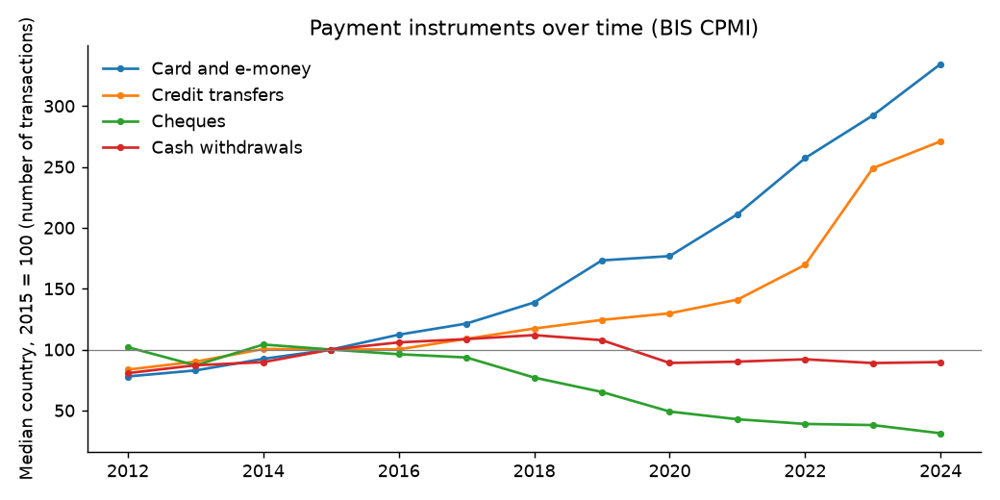
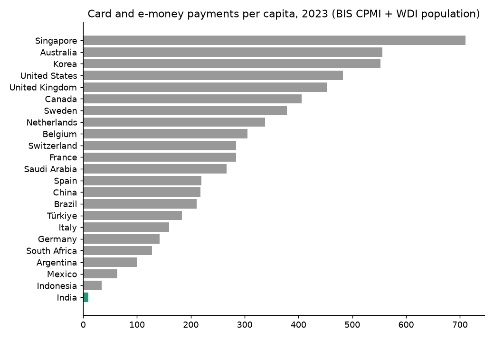

# BIS CPMI cashless payments: cross-country analysis

Source: BIS CPMI "Statistics on payment, clearing and settlement systems" (`bis.ws_cpmi_cashless`: 19,514 rows, 26 reporting countries, annual 2012-2024),
joined with World Bank WDI population and annual-average exchange rates (country mapping through the WDI 2-letter codes). Script `scripts/bis_cpmi_analysis.py`;
numbers in `BIS_CPMI_ANALYSIS.json`. **Pakistan is not a CPMI reporter, so none of this is Pakistan data**; India is the closest comparator.

## Method and validation
- The BIS table repeats each total under many dimension combinations (issuer side, acquirer side, by card function, ...). I kept the headline rows (all device/terminal/function/speed/issuer; issued- or used-inside-country) and one value per country-year-instrument, giving 4,062 rows.
- Check: the sum of card + credit transfers + direct debits + cheques + other instruments equals the BIS "cashless payments, all" total within 5% in 98.7% of 302 country-years (median ratio 1.000). Example: India 2023 adds up exactly.
- Values were converted to USD with the WDI exchange rate (all rows matched), so average ticket sizes are approximate.

## Findings

**1. Cashless payments moved to cards, then to account-to-account transfers.** (median country, 2015 = 100, number of transactions)
- Card and e-money payments grew in every one of 23 countries between 2015 and 2023, with a median of +15.5% a year (range +1.1% Singapore to +47.8% Saudi Arabia).
- Credit transfers grew in every country, median +10.6% a year; India grew 61.7% a year.
- Cheques fell in all 23 countries (median -15.9% a year). Cash withdrawals fell in 71% of 21 countries (median -4.1% a year).
- 

**2. Card use per person varies by a factor of about 75.** Card and e-money payments per capita in 2023: Singapore 711, Australia 556, Korea 552, United States 483, UK 454, China 218, Brazil 211, Turkiye 183, Mexico 63, Indonesia 35, India 9.5.
- 

**3. India shows the account-to-account shift most clearly.** Transactions in millions:
| | 2015 | 2019 | 2023 | 2024 |
|---|---|---|---|---|
| Credit transfers | 2,874 | 18,486 | 134,012 | 192,284 |
| Card and e-money | 2,736 | 12,275 | 13,677 | 13,245 |
| Cash withdrawals | 8,082 | 9,588 | 6,758 | 6,199 |
| Cheques | 1,096 | 1,070 | 673 | 626 |
- Card and e-money payments were flat from 2019 while credit transfers rose more than tenfold; card payments per cash withdrawal were 2.0 in India against a median of 15.5 across the countries. India's fast-payment growth is in credit transfers, not cards.
- That pattern matters for a Pakistan payments platform: a country with low card use can leap to instant account-to-account payments, so a design built only around card authorisation would miss most volume. This is a pattern from the data, not a forecast for Pakistan.

**4. Average card payment** in 2023 had a median of USD 33.9 across 23 countries (Indonesia 10.7, India 23.7, UK 42.2, China 62.4, United States 66.4).

**5. Mix of instruments by number (median country, 2023):** card and e-money 68.1%, credit transfers 20.6%, direct debits 7.2%, cheques 0.1%, other 0.1%.

## Caveats
- Cross-country definitions differ (for example e-money wallets are counted as card/e-money payments; India's UPI counts as credit transfers).
- Exchange-rate conversion uses annual averages, so ticket sizes are approximate and distorted in high-inflation, depreciating currencies (Argentina, Turkiye).
- Not every country reports every instrument or year (23 of 26 reporters have card data in 2023).
- Descriptive only: no causal claims about what drove the shifts.
