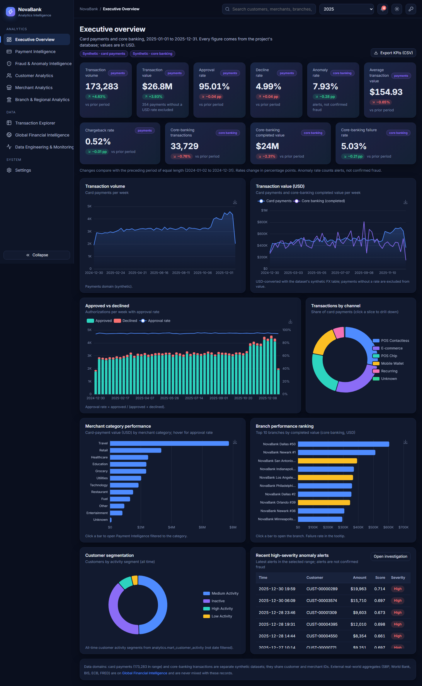

# Dashboard (React)

Live: https://banking-transaction-analytics.vercel.app (a read-only snapshot of the synthetic data, see [DEPLOYMENT.md](DEPLOYMENT.md)); locally at `http://127.0.0.1:8792/app/`.

One React app (`web/react-app`, served by the API at `/app/`) holds every dashboard in the project. It is a ten-page analytics UI with a dark and a light theme; see [UI_UPGRADE_PROGRESS.md](UI_UPGRADE_PROGRESS.md) for what was built, how it was verified and the known limits.



| Page | Route | Data | Source |
|---|---|---|---|
| Executive overview | `/overview` | 6 headline KPIs with period-over-period change, trends, channel and category mix, top branches, segments, high-severity alerts | synthetic, `/v1/overview*` |
| Payment intelligence | `/payments` | lifecycle Sankey (from recorded events only), funnel, trends, amount distribution, refunds/reversals/chargebacks, decline reasons, category treemap, hour-by-weekday heatmap; filters: date, channel, category, merchant, status | synthetic, `/v1/payments/*` |
| Fraud & anomaly | `/fraud` | alert volume and severity, categories, Isolation Forest score distribution, amount-vs-score scatter, customer and merchant risk, heatmap, rule-vs-ML comparison, investigation table with saved status, payment scoring form | synthetic, `/v1/anomalies/*` |
| Customer analytics | `/customers`, `/customers/:id` | RFM segments, recency x frequency, activity trend, spend distribution, cohort retention, estimated CLV (assumptions adjustable), customer detail pages | synthetic, `/v1/customers/*` |
| Merchant analytics | `/merchants`, `/merchants/:id` | category performance, risk-index ranking, merchant detail with decline reasons | synthetic, `/v1/merchants/*` |
| Branch & regional | `/branches`, `/branches/:id` | MapLibre map (city centroids), regional comparison, rankings, completion rates, branch detail | synthetic, `/v1/branches/*` |
| Transaction explorer | `/explorer` | nine server-side tables (transactions, card payments, payment failures, customers, merchants, branches, anomalies, pipeline runs, data quality) with search, multi-sort, column filters, column visibility, resizable columns, row selection, expandable rows, CSV and Excel export | synthetic + pipeline metadata, `/v1/tables/*` |
| Global financial intelligence | `/global` | 63 charts and tables from SBP, World Bank, BIS, ECB, FRED and Global Findex, including backtested forecasts of five real series; kept separate from the transactions | real aggregates, `public/analysis.json` |
| Real vs synthetic | `/benchmarks` | scorecard of real SBP payment metrics against the dashboard's synthetic data and a calibrated companion; what was and was not calibrated | real + synthetic, `/v1/benchmarks`; see [CALIBRATION_AND_FORECASTS.md](CALIBRATION_AND_FORECASTS.md) |
| Data engineering & monitoring | `/engineering` | pipeline runs, ingestion, data quality, reconciliation, freshness, dbt results, Airflow (live only when `AIRFLOW_BASE_URL` is set), error log | real pipeline metadata, `/v1/observability/*` |
| Settings | `/settings` | theme, session, data domains, definition of every headline metric | `/v1/meta` |

Every page carries a badge saying whether its data is **synthetic**, **real** (published aggregate statistics or real pipeline metadata) or **simulated**. Value metrics are in USD, converted with the dataset's own synthetic FX table.

The global date range is kept in the URL (`?from=&to=`); the default is 2025 so the previous-period comparison (2024) has data. Charts follow the active theme.

## Static analysis data (global page)
### Sections
Overview (10 KPI tiles), Macro and monetary (policy rate vs inflation, policy-rate history, USD/PKR, repo vs policy rate, GDP growth, reserves, inflation, remittances, balance of payments), Banking system (capital, NPLs, ADR spike, sector NPLs, NPL categories, financial depth), Payments (retail volume by quarter, digital share, channel share and growth, Raast, POS/ATM/QR infrastructure, users, cards, FY2018 channels), International comparison (BIS card use and instruments, WDI peers, policy rates across central banks, ECB rates and inflation, Pakistan vs euro-area banks), Cross-border finance (BIS claims, claims by headquarters country, external debt, debt composition, remittance costs), Financial inclusion (Findex trend, peers, women, ranks, WDI extremes), Fraud models (PR-AUC by dataset, including real card transactions), Data quality (reconciliation scoreboard), Forecasts (real series), ECB payments and FRED (euro-area payments per inhabitant by instrument, card payments by country, euro-area card-fraud rate, US CPI, Fed rates).

Every chart shows its source and notes. Values are not typed into the front end: they come from the JSON results written by the analysis scripts.

## Rebuild
```
python scripts/create_ui_objects.py         # creates the ui schema (materialized views, city centroids); the API also does this on start-up if missing
python scripts/allinone/run_all.py          # recompute the analysis parts (reads the warehouse read-only)
python scripts/export_dashboard_data.py     # writes web/react-app/public/analysis.json
cd web/react-app && npm run build           # bundle; the API serves web/react-app/dist at /app/
```

## Tests
- `npm test` (vitest): every chart spec is valid and converts to a chart with data for each series; number formatting.
- `npx playwright test` (needs the API, Postgres and `npm run build`): all eleven routes load without console errors, KPI values equal the API for two date ranges, the date preset changes the KPIs, theme toggle persists, charts render, the explorer sorts, pages, searches and exports server-side, customer detail opens from the table, the map renders, an API failure shows an error state with retry, no page overflows horizontally at 390 px, global search returns results.
- `pytest tests/test_dash_api.py`: KPI values against independent SQL, USD conversion, lifecycle conservation, filters, pagination/sort, injection rejection, export, anomaly summary, investigation round trip, RFM coverage, CLV assumptions, observability, API-key enforcement.

## Payments metric definitions (match `docs/BUSINESS_METRICS.md`)
```
Approval Rate   = SUM(approved) / (SUM(approved) + SUM(declined))
Completion Rate = SUM(cleared)  / SUM(approved)
Settlement Rate = SUM(cleared settled) / SUM(cleared)
Decline Rate    = SUM(declined) / (SUM(approved) + SUM(declined))
```
Never average the daily rates; recompute from sums. Check values for the whole synthetic period: approval 95.07%, completion 97.03%, settlement 99.57%, 492,212 dated payments (987 payments with invalid authorization timestamps are excluded from the daily marts by design). The reconciliation queue has 15,783 rows, all OPEN after the latest run.

## Extracts for other tools
`data/processed/bi/` (CSV and Parquet; dictionary in `docs/BI_EXTRACTS_DICTIONARY.md`, regenerate with `PYTHONPATH=. python scripts/export_payment_bi_extracts.py`) remain available for spreadsheets or any BI tool; nothing in the project depends on them.
