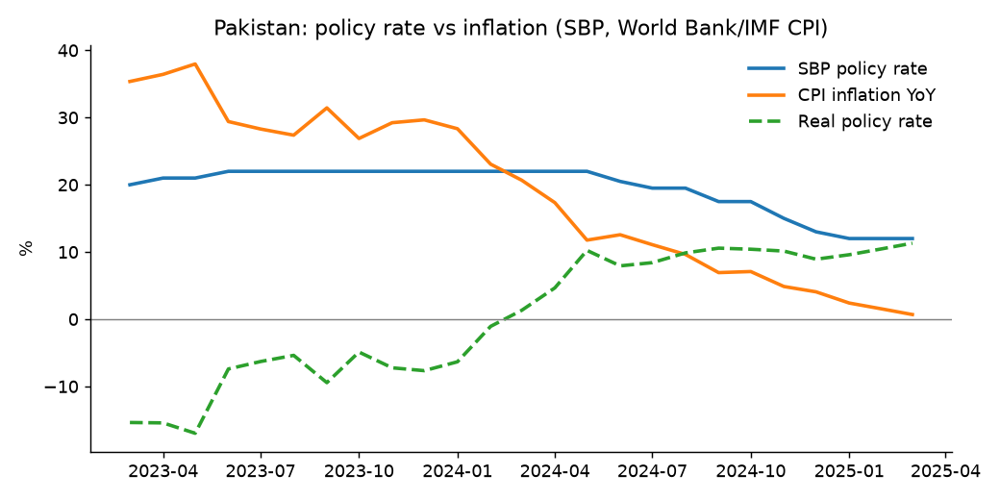
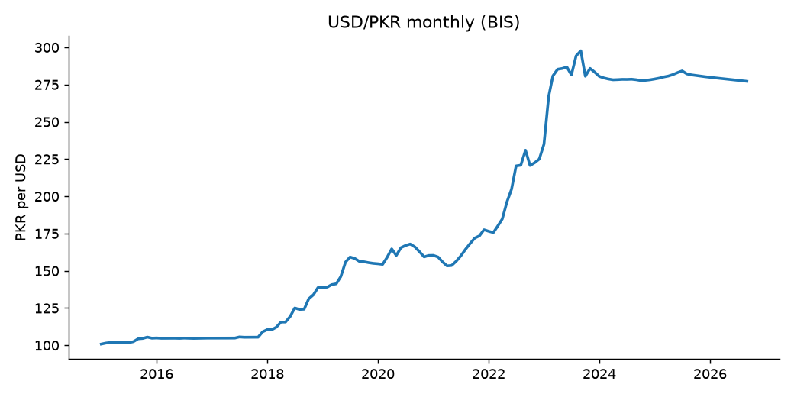
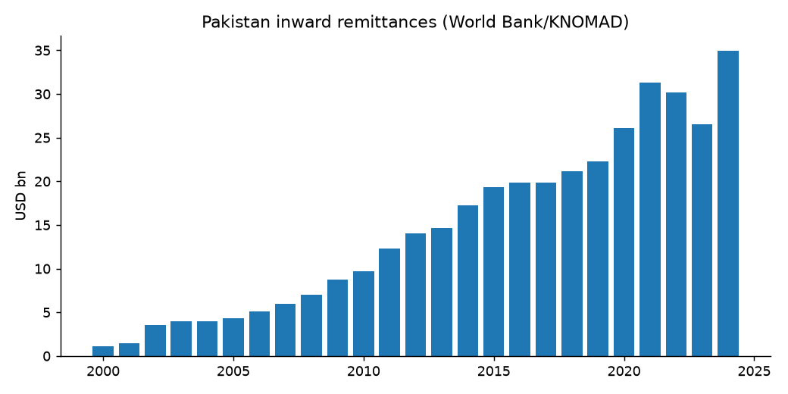
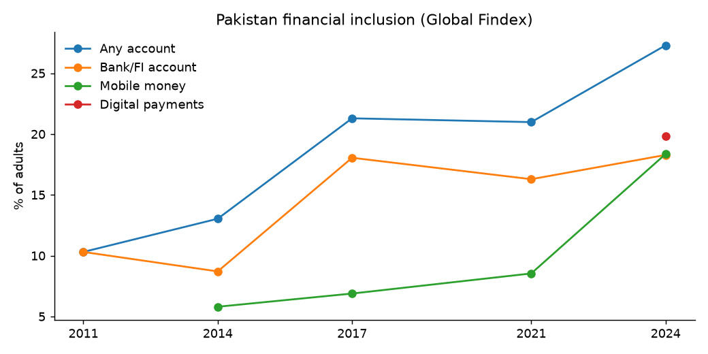

# Pakistan macro and financial-inclusion analysis (real data)

Generated by `scripts/pakistan_macro_analysis.py`; all numbers in `PAKISTAN_ANALYSIS.json`. Sources: SBP (policy rates parsed from the
`sir` PDF table), BIS (USD/PKR, `ws_xru`), World Bank/IMF headline CPI, World Bank KNOMAD remittances, World Bank Global Findex 2025.
No synthetic data is used on this page.

## Findings

**1. Policy rate vs inflation (Mar 2023 - Mar 2025, 25 months)**
- SBP policy rate peaked at 22.0% (27 Jun 2023) and fell to 10.5% (16 Dec 2025). The table also lists 12.0% from 27 Oct 2026 (as given in the SBP file).
- CPI inflation peaked at 38.0% YoY in May 2023, and was 0.7% in Mar 2025 (the last month in the World Bank file).
- The real policy rate was deeply negative in 2023 (low: -17.0% in May 2023), turned positive around Feb-Mar 2024, and was +11.3% in Mar 2025.
  Policy stayed at 22% for about a year while inflation fell from 38% to 12%, which is why the real rate climbed.
- 

**2. PKR**
- USD/PKR (BIS monthly average): 100.8 (Jan 2015) -> 176.5 (Jan 2022, +75%) -> 297.7 (Sep 2023, +68.6% in 20 months) -> 277.2 (Sep 2026, -6.9% from the Sep 2023 level).
- The rupee fell sharply through the 2022-23 crisis (the same window as the inflation peak) and has partly recovered since.
- 

**3. Remittances (USD m)**
- 19,856 (2017) -> 34,914 (2024), a 8.4% CAGR. 2022 and 2023 fell (30,176 and 26,558) before a 31% rebound in 2024.
- 

**4. Financial inclusion (Global Findex)**
| Year | Any account | Bank/FI account | Mobile money | dig_acc (definition unverified) |
|---|---|---|---|---|
| 2011 | 10.3% | 10.3% | n/a | n/a |
| 2014 | 13.0% | 8.7% | 5.8% | n/a |
| 2017 | 21.3% | 18.0% | 6.9% | n/a |
| 2021 | 21.0% | 16.3% | 8.5% | n/a |
| 2024 | 27.3% | 18.3% | 18.4% | 19.8% |

- Mobile money rose from 8.5% to 18.4% between 2021 and 2024 and now almost equals bank accounts (18.3%).
- Gender gap in account ownership (2024): men 42.3%, women 11.9%, a 30.4-point gap. It was 14.3 points in 2011.
- 

## Caveats (read before citing)
- **The policy-rate series only starts in Mar 2023** (that is what the SBP table covers), so the policy/inflation/FX joins cover 25 months.
- **Lead-lag correlations are not reliable.** Correlation of policy rate with inflation at t+k was 0.79 (k=0), 0.66 (3), 0.34 (6), -0.50 (9), -0.79 (12), but both series trend over a short window and the k=12 case uses only 13 points. This is descriptive and must not be read as a causal effect of rates on inflation.
- The SBP rows were parsed from a PDF-to-table extraction; column meaning (ceiling, floor, policy, minimum saving deposit rate) was inferred from the header and checked against the known 2023 history (e.g. 20% to 21% to 22% policy rate). Values from the file are used as they are, including dates after today's real-world data I can verify.
- World Bank CPI ends Mar 2025, so there is no inflation data for the later period.
- Findex is survey based (sampling error not shown here); the 2011 mobile/digital fields are missing.
- BIS has no Pakistan policy rate, CPI, or credit-gap series, but (correction) it does have Pakistan as a counterparty in its locational and consolidated banking statistics; see `ALL_IN_ONE_ANALYSIS.md` Part D. The Findex column labelled `dig_acc` was called 'digital payments' here on assumption; the codebook is not in the warehouse.
