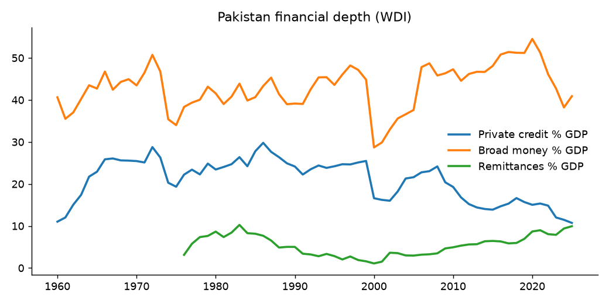
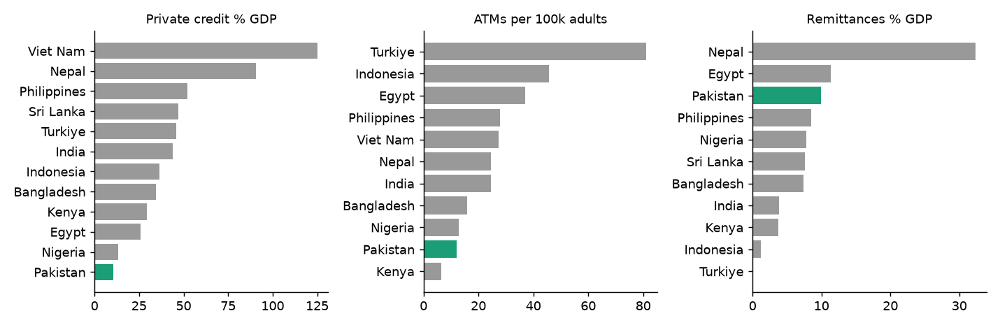
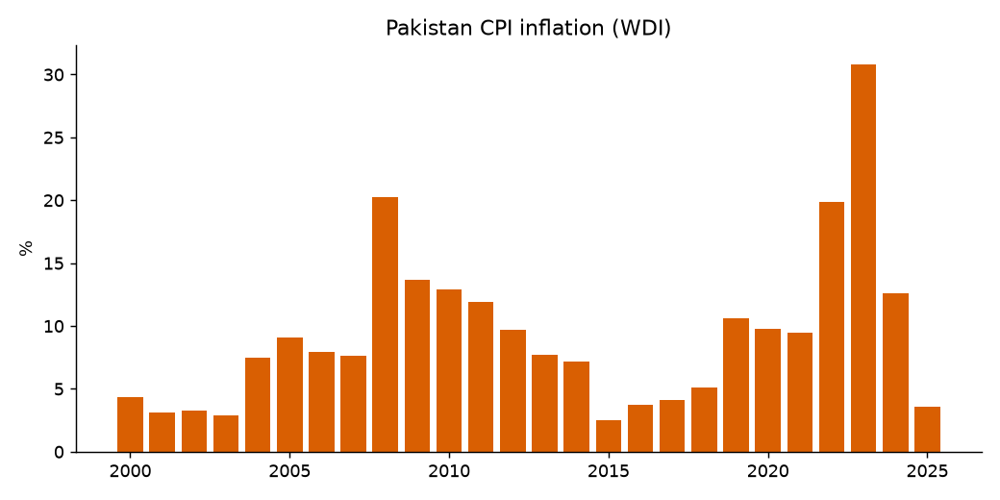

# Pakistan banking sector vs peers (World Development Indicators)

Source: World Bank WDI (`worldbank.d0037712_dr0095335_csv_file_wdicsv`, loaded from the downloaded CSV). Script `scripts/pakistan_wdi_analysis.py`; all numbers
in `PAKISTAN_WDI_ANALYSIS.json`. Peers: India, Bangladesh, Sri Lanka, Nepal, Egypt, Indonesia, Turkiye, Nigeria, Viet Nam, Philippines, Kenya.
Latest value used per country within 2018-2025 (the year differs by indicator; see the Year column). Real data only.

## Findings

**1. Pakistan has the lowest private credit of the 12 countries.**
- Domestic credit to the private sector is 10.7% of GDP (2025) against a peer median of 44.0%. It was 29.8% in 1986 and 24.2% in 2008, so the sector has shrunk relative to the economy, not grown.
- Broad money is 40.9% of GDP (peer median 59.5%, rank 10 of 12).
- 

**2. Access infrastructure is improving but thin.**
| Indicator (latest) | Pakistan | Peer median | Pakistan rank (high to low) |
|---|---|---|---|
| Private credit % GDP (2025) | 10.7 | 44.0 | 12 of 12 |
| Broad money % GDP (2025) | 40.9 | 59.5 | 10 of 12 |
| ATMs per 100k adults (2024) | 12.1 | 25.9 | 10 of 11 |
| Bank branches per 100k adults (2024) | 11.2 | 9.1 | 6 of 12 |
| Borrowers from commercial banks per 1,000 adults (2024) | 23.3 | 228.9 | 7 of 7 reporting |
| Remittances % GDP (2025) | 9.9 | 7.5 | 3 of 11 |
| Mobile subscriptions per 100 (2024) | 76.9 | 108.1 | 11 of 12 |
| GDP per capita, US$ (2025) | 1,596 | 3,086 | 10 of 12 |

- ATMs per 100k adults tripled from 3.96 (2010) to 12.05 (2024); branches rose from 7.76 to 11.15.
- Branch density is above the peer median, but only 23 per 1,000 adults borrow from commercial banks, about a tenth of the median of 229 (only 7 of the 12 report this indicator).
- 

**3. Macro context**
- CPI inflation peaked at 30.8% in 2023 (since 2000) and was 3.5% in 2025. USD/PKR rose 172.8% between 2015 and 2023 (annual average). Reserves were 3.76 months of imports in 2025.
- 

**4. Remittances are large relative to credit.** At 9.9% of GDP, remittances are third highest among the peers while private credit is the lowest. Over 1990-2024 the Spearman correlation between remittances and credit (both % GDP) is -0.79 in levels but -0.33 in first differences, and the levels figure mostly reflects opposite long-run trends (credit falling, remittances rising), not a causal link.

## Caveats
- Correlations use 35 annual points and are descriptive. Levels trend, so first differences are reported alongside.
- WDI series differ in definition and year across countries; the table uses the latest value in 2018-2025 for each country, so years are not perfectly aligned.
- Borrowers per 1,000 is reported by only 7 of the 12 countries, so its rank is among those 7.
- Inflation of 3.5% for 2025 is the WDI value in the downloaded file; the earlier World Bank/IMF monthly CPI file (ending Mar 2025) and this one come from different sources and are not reconciled here.
- Only banking-related indicators were extracted; WDI has 1,498 Pakistan series, most not examined.
