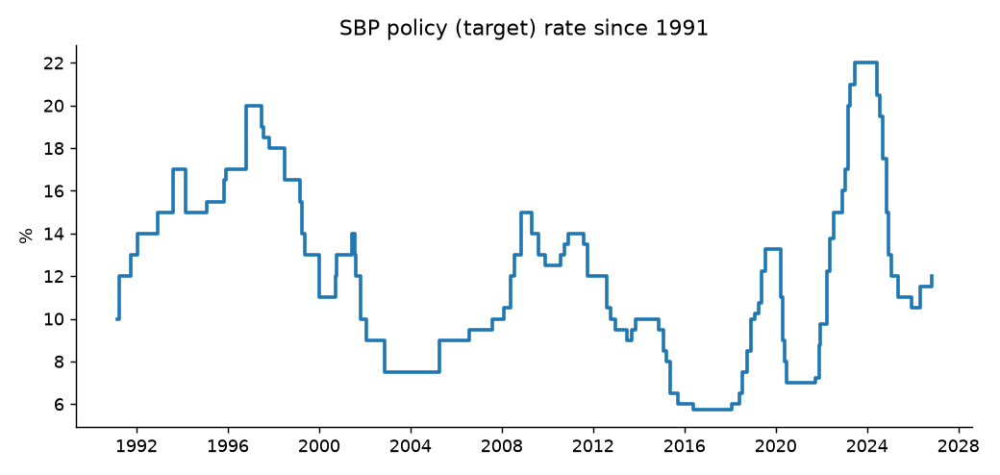
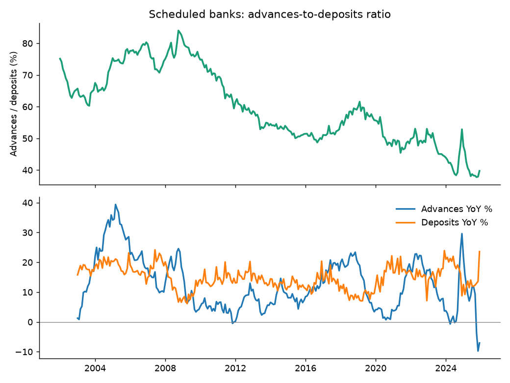
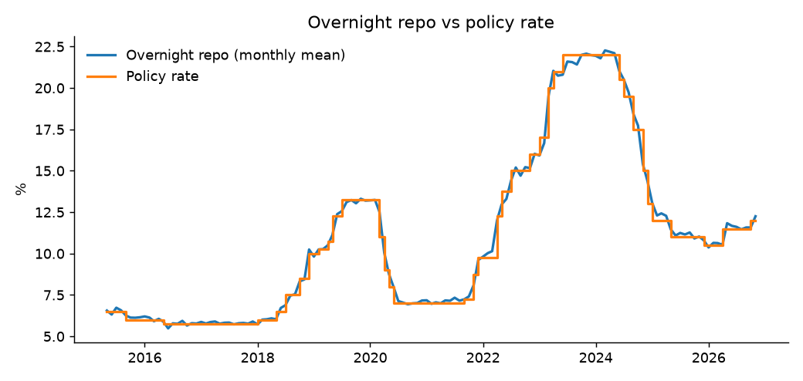

# State Bank of Pakistan data analysis

Source: SBP tables extracted from PDFs by OCR into `sbp.rows_parsed` (see `docs/DATA_WAREHOUSE.md`). Script `scripts/sbp_analysis.py`; all numbers in `SBP_ANALYSIS.json`.
Amounts are Rs million as published. Real data only.

## Findings

**1. Policy rate, 1991 to Oct 2026 (90 recorded changes: 46 hikes, 42 cuts)**
- Peak 22.0% (27 Jun 2023); low 5.75% (23 May 2016); latest 12.0% (27 Oct 2026). Largest single hike +3.0 pp (22 Oct 1996); largest single cut -2.5 pp (5 Nov 2024).
- 

**2. Banks lend a shrinking share of their deposits** (scheduled banks, monthly, Jan 2002 - Dec 2025, 288 months)
- Advances-to-deposits ratio: 75.1% (Jan 2002) -> peak 84.0% (Oct 2008) -> 52.9% (Dec 2024) -> low 37.8% (Oct 2025); 39.8% in Dec 2025.
- Over the 24 years advances grew 12.0% a year against 15.0% for deposits.
- 
- **Data oddity:** advances rise from Rs 12.3tn (Sep 2024) to Rs 16.0tn (Dec 2024), +30% in three months with flat deposits, then fall back through 2025. I can't tell from this file whether it is a genuine temporary surge, a reclassification or a data break. The -9.8% advances growth in Nov 2025 is largely the base effect of this spike; treat the 2024-25 ratio with caution.

**3. Credit is dominated by lending to government** (Jun-25, Oct-25, Jun-26, Oct-26P)
- Credit to government Rs 36.2tn (Jun-25) vs private-sector credit Rs 9.9tn; government is 73.7% of total credit (Jun-25) and 72.8% (Jun-26).
- Jun-25 to Jun-26: government credit +6.0%, private credit +14.7%, personal (consumer) credit +25.2%. Personal credit rises from 12.5% to 13.6% of private credit (15.9% by Oct-26P).
- This agrees with the World Bank result that private credit is only about 11% of GDP (`PAKISTAN_WDI_ANALYSIS.md`).

**4. Overnight repo follows the policy rate closely** (2,808 daily observations, 25 May 2015 - 18 Nov 2026)
- Monthly mean repo minus policy rate: mean +0.04 pp, 5th to 95th percentile -0.66 to +0.79 pp; within 1 pp in 94.2% of 139 months. Median day-to-day move 0.14 pp.
- Yearly average repo: 6.3% (2015), 5.8% (2017), 11.9% (2019), 13.3% (2022), 20.4% (2023), 19.7% (2024), 11.6% (2025), 11.3% (2026).
- 

**5. Non-performing loans, Mar-26 vs Jun-26 (Rs million)**
| Group | NPLs Mar-26 | NPLs Jun-26 | Net NPLs Jun-26 | Net NPL to net loans Jun-26 |
|---|---|---|---|---|
| All banks and DFIs | 927,934 | 918,107 | -93,561 | -0.61% |
| All commercial banks | 887,481 | 879,667 | -95,493 | -0.63% |
| Public sector banks | 312,961 | 317,160 | -26,616 | -1.04% |
| Local private banks | 574,130 | 562,118 | -67,889 | -0.56% |
| Foreign banks | 390 | 389 | -989 | -0.23% |
| Specialized banks | 23,344 | 21,404 | 4,366 | +3.03% |
| Digital banks | 871 | 994 | -751 | -2.56% |
- Net NPLs are negative for most groups: provisions exceed gross NPLs. Specialized banks are the only group with a positive net ratio. Gross NPLs fell about 1.1% in a quarter overall but rose for public sector banks (+1.3%) and digital banks (+14%, from a very small base).
- The table gives net, not gross, NPL ratios, so I did not compute a gross NPL ratio.

## Caveats
- The tables were extracted by OCR; I validated by checks (the repo series tracks policy rates, M2 components add up), but individual cells can be wrong. The 2020 rows were read correctly after fixing a parsing bug (rows labelled `2020**`).
- Policy-rate dates and the latest values come as given in the SBP files.
- ADR and growth correlations: Spearman of ADR vs policy rate levels 0.07 and advances growth vs 12-month policy change 0.35 are descriptive only; there is no causal control.
- Credit table has only four snapshots, so growth rates are Jun-25 to Jun-26 point-to-point.
- Not analysed from SBP: M2/M3/reserve money components, balance of payments, GDP tables, sector credit breakdown, FX rates.
