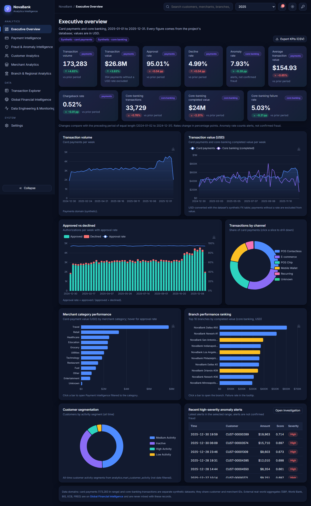
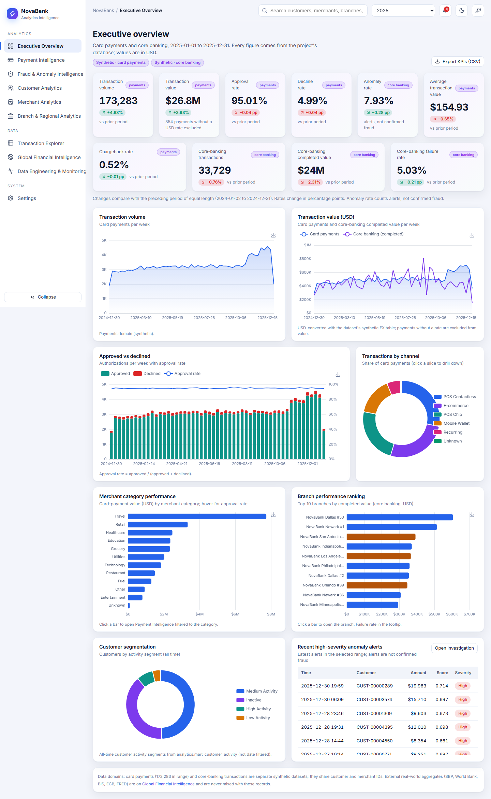
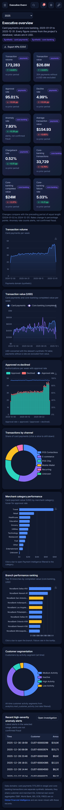
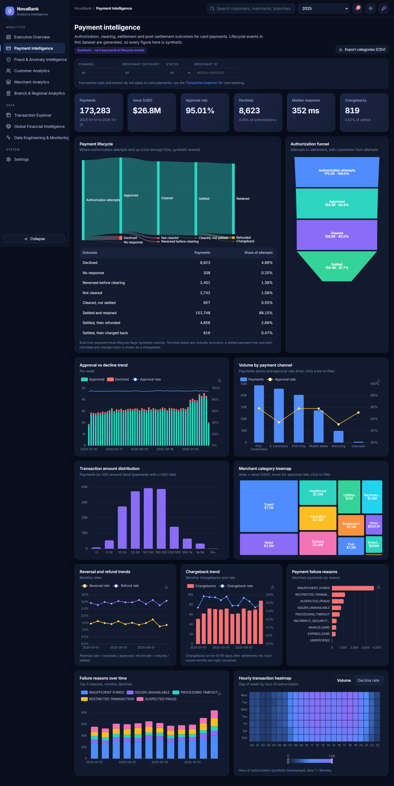
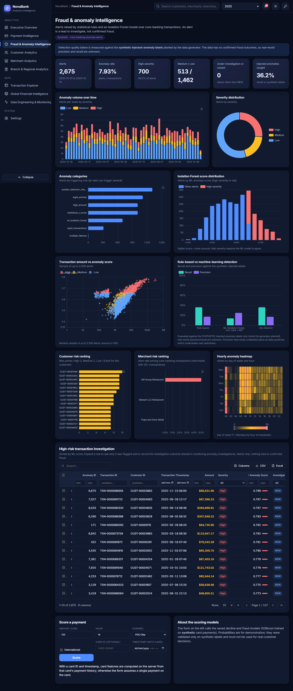
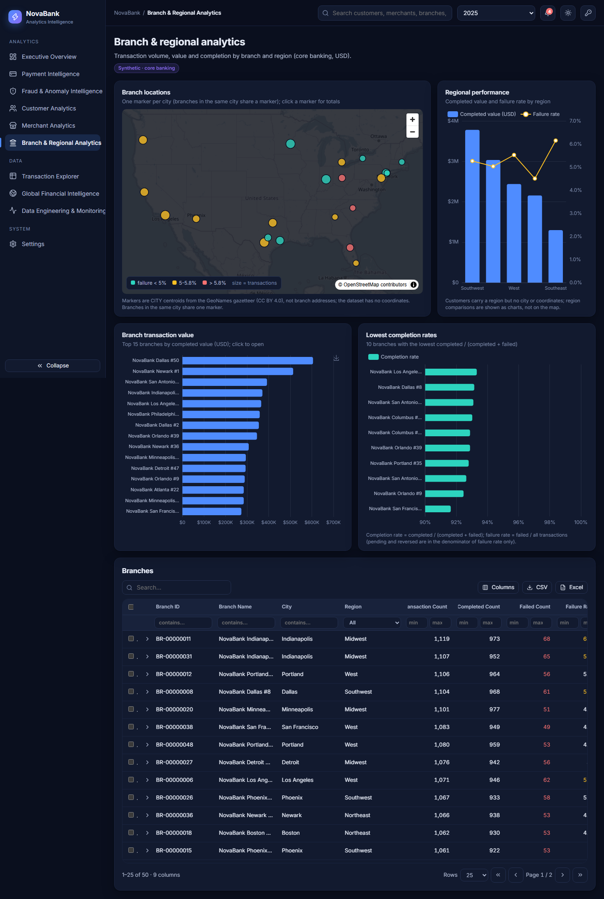

# NovaBank 2.0 UI upgrade: what was built and how it was checked

Plan and audit: [UI_UPGRADE_PLAN.md](UI_UPGRADE_PLAN.md). Page guide: [DASHBOARD.md](DASHBOARD.md).

| | Dark | Light | Phone |
|---|---|---|---|
| Overview |  |  |  |

## Phases
1. **Audit and plan** (`UI_UPGRADE_PLAN.md`): data inventory, gaps and the decision taken for each.
2. **Backend** (`src/api/dash/*`, `sql/ui_views.sql`, `scripts/create_ui_objects.py`): `/v1` routers with SQL aggregation, bound parameters, in-process TTL cache, optional `X-API-Key`. USD-converted `ui` materialized views, investigation table `monitoring.anomaly_investigations`, server-side tables with export. 17 tests.
3. **Design system and shell** (`src/style`, `src/ui`, `src/app/Shell.jsx`): tokens for dark and light, collapsible sidebar (drawer on phones), breadcrumbs, global search, notification centre, date range in the URL, theme switch, KPI cards, chart cards with loading / error / empty states, ECharts wrapper that reads theme tokens.
4. **Executive overview, payments, fraud, customers, merchants, branches, explorer, global intelligence, engineering, settings**: ten routes plus customer, merchant and branch detail pages.
5. **Tests**: see below.

## Verification (all run on this machine, against real API + Postgres)
| Check | Result |
|---|---|
| `pytest` (whole repo) | 100 passed |
| `npm test` (vitest) | 6 passed |
| `npx playwright test` | 21 passed |
| `vite build` | succeeds; ECharts and MapLibre are separate lazy chunks (about 238 kB and 218 kB gzip), pages are code-split |
| Screenshots | each page checked in dark and light; overview also at 390 px |

Defects found and fixed during verification (kept here because they changed behaviour): CARTO basemap tiles now demand an API key, so the map uses OpenStreetMap tiles (dimmed in dark mode); `setStyle` on mount removed the marker layer; a full 50,000-row CSV export took 68 s because the generator yielded per row, now 2 s; a table without a scroll container and a single-column grid track forced horizontal scroll on phones; default range "all data" left every comparison empty, so the default is 2025.

## Data honesty (decisions that matter when reading the numbers)
- All transactional data is **synthetic**. External pages use **real** published aggregates and are never joined to transactions.
- Value metrics are USD via the dataset's synthetic FX table (last rate on or before the date). Rows whose currency has no rate stay in volume but are excluded from value.
- "Anomaly rate", not "fraud rate": there are no confirmed-fraud labels. Injected-anomaly labels from the simulator are used only to evaluate detection (rules recall 36%, Isolation Forest recall 13% on this data) and are shown as such. Investigation status (NEW, INVESTIGATING, CONFIRMED_FRAUD, FALSE_POSITIVE, CLOSED) is analyst input stored in the database.
- The Sankey shows only lifecycle transitions that exist in recorded events.
- The map plots **city centroids** from GeoNames (CC BY 4.0), not branch addresses, because the data has no coordinates; branches in one city share a marker. Basemap tiles need internet access.
- CLV is an **estimate** = average monthly completed USD x revenue rate (default 1.5%) x lifetime (default 36 months); both are adjustable on the page. Customers with fewer than 3 completed transactions are excluded.
- RFM uses quintile scores relative to the selected range; the segment rules are printed on the page.
- Merchant risk index is a relative z-score composite of decline and chargeback rates, not a probability.
- Engineering page: pipeline, ingestion, data-quality and reconciliation come from the project's audit tables; dbt status is the **last invocation** in `target/run_results.json`; Airflow run status is shown only when `AIRFLOW_BASE_URL` is set, otherwise the page says "not connected" and lists the DAG definitions parsed from `airflow/dags`.
- Notifications are derived from real records (high-severity alerts, failing checks); there is no separate alerting service.

## Not done / limits
- No user accounts or roles: access is a single optional API key.
- Date presets such as "last 30 days" are relative to the end of the data (2025-12-31), not today.
- Tables export at most 50,000 rows per file (Excel is built in memory).
- No visual-regression suite; screenshots were reviewed by eye.
