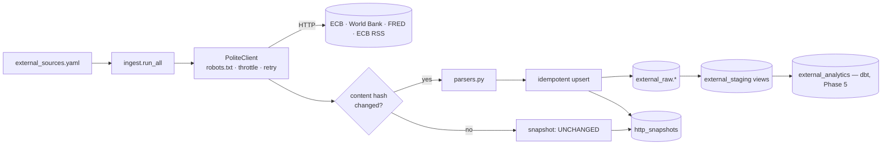

# External Data Collection (Module B)

Public, officially published sources only. **API/feed first, HTML scraping only where no feed exists.** Code: `src/external/`; sources: `config/external_sources.yaml`; DDL: `sql/ddl/07_create_external_tables.sql`.

## Enabled sources (verified live 2026-11-20)
| Source | Method | Data | Target |
|---|---|---|---|
| ECB euro reference rates | official XML (`eurofxref-hist.xml`) | EUR-base daily FX since 1999 | `external_raw.exchange_rates` |
| World Bank API v2 | JSON | CPI inflation, GDP growth, official exchange rate for PK, US, GB, IN, AE, DE, FR, CA | `external_raw.economic_indicators` |
| FRED | public CSV download (`fredgraph.csv`) | DFF (fed funds), CPIAUCSL, UNRATE | `external_raw.economic_indicators` |
| ECB press RSS | official RSS | central-bank announcements | `external_raw.industry_announcements` |

## Not enabled (and why)
Visa, Mastercard, SBP and other payment-industry HTML pages are **not** collected: they are largely JavaScript-rendered and/or restrict automated access, and no official machine-readable feed was verified. A config-driven BeautifulSoup parser (`parse_announcement_html`) exists and is unit-tested on a fixture, but no live site is wired to it; add one only after reading its `robots.txt` and terms. Scrapy and Playwright were not added: nothing here needs a crawler framework or a headless browser (not adding technologies for show). Published interchange fee schedules and payment statistics are therefore **not yet available**, so processing-cost estimates remain unimplemented.

## Behaviour
* **robots.txt** is fetched per host and enforced (`RobotsDisallowed` → snapshot `BLOCKED_ROBOTS`, nothing fetched). No CAPTCHA/auth bypass.
* **Throttling:** minimum interval per domain (default 1 s; FRED asks for a 1 s crawl-delay). **Retry:** 429/5xx and network errors with exponential backoff, honouring `Retry-After`.
* **User-Agent:** generic `NovaBankPortfolioBot/1.0`; no personal contact details are sent.
* **Snapshot log** (`http_snapshots`, append-only): URL, domain, extraction timestamp, HTTP status, extraction status (`SUCCESS`/`UNCHANGED`/`FAILED`/`BLOCKED_ROBOTS`), parser version, SHA-256 content hash, `changed`, records parsed/new, attempts, error. Every record links to its `snapshot_id` (historical record identifier).
* **Incremental / change detection:** unchanged hash ⇒ no parsing, no writes. `--force` re-parses.
* **Idempotency / duplicate prevention:** business-key primary keys + `ON CONFLICT DO UPDATE` (revisions overwrite, history retained in snapshots).
* **Failure isolation:** a failing or malformed source is logged and the remaining sources continue.

## Measured
Live run, dev database, 2026-11-20: a first run (with the 90-day ECB file) loaded 1,856 FX rows, 190 World Bank observations, 3,454 FRED observations and 15 ECB press items, and an immediate second run reported all 8 sources `UNCHANGED` with zero writes. Switching to the ECB full-history file then loaded 222,108 rate rows (1999-01-04 to 2026-11-19, 41 currencies); that single load took roughly 3 minutes wall-clock (not a controlled benchmark).

## Limitations
* Real ECB FX is EUR-based; cross rates to USD are derived downstream. The synthetic payments still use their own seeded FX series; wiring real rates into reconciliation is a later step.
* World Bank/FRED data are low-frequency macro series (annual/monthly), suitable as context features, not transaction-level inputs.
* Upserts use batched `executemany`; the ECB full history (~222K rows) took about 3 minutes; a COPY-based upsert is a Phase 4 optimisation.

Run: `python -m src.external.ingest [--only NAME ...] [--force]`. Tests: `tests/test_external.py` (parsers, client with a fake session, DB-backed incremental/idempotency/failure/robots tests; no network needed).
